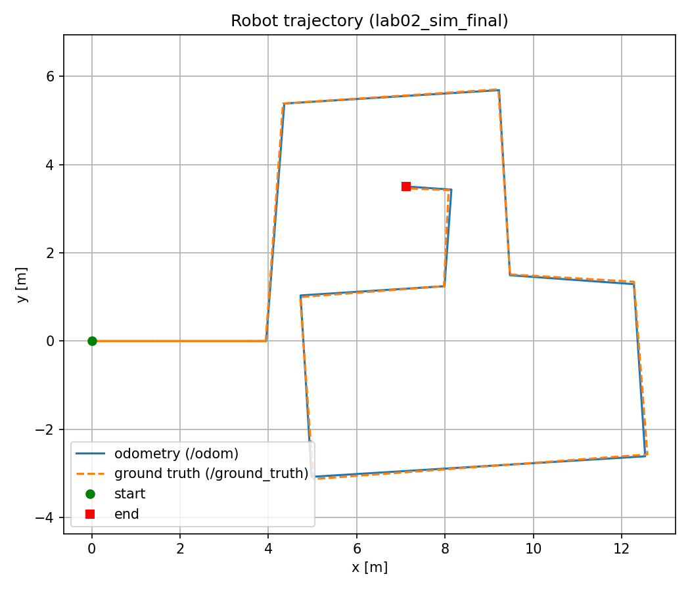
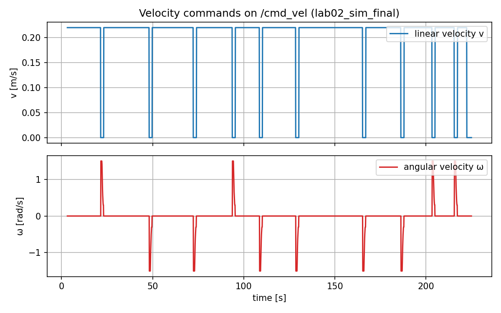
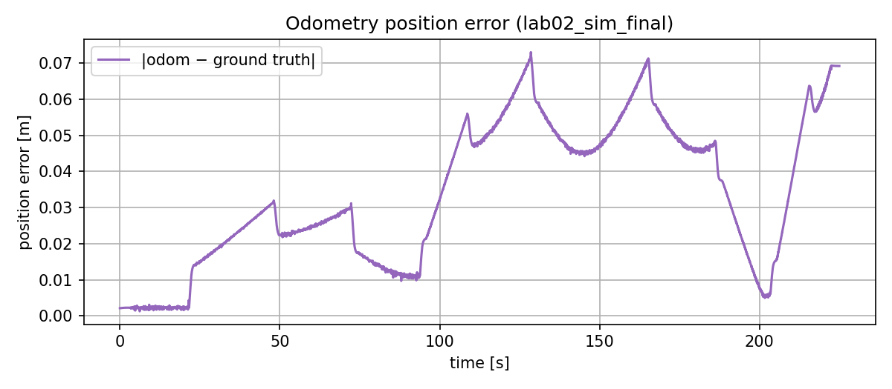
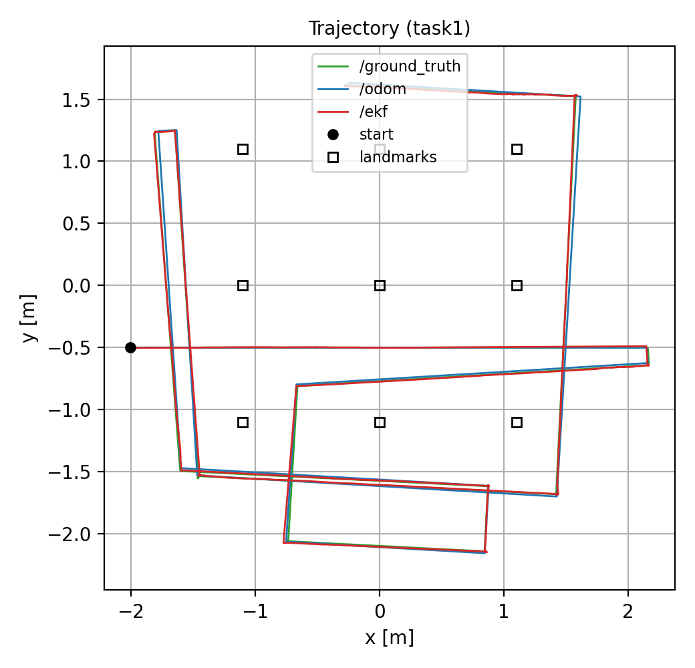
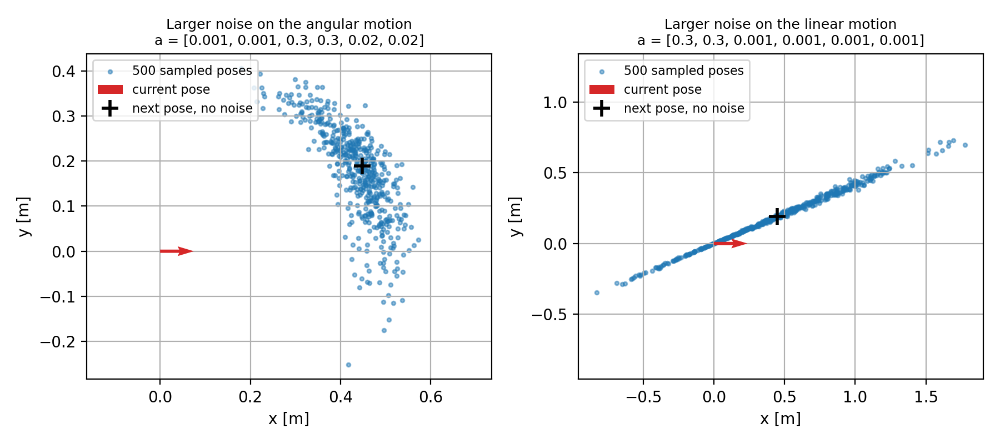

<div align="center">

# 🐢 SESASR-SIQUBro

**Attività di laboratorio del gruppo 203 (SIQUBro) per il corso *Sensors, Embedded Systems and Algorithms for Service Robotics* (SESASR), Politecnico di Torino.**<br>
TurtleBot3 in simulazione e sul robot reale: Bump&Go, localizzazione con EKF, navigazione con DWA.

   

[English](README.md) · [中文](README.zh-CN.md) · [Guida operativa (in inglese)](docs/OPERATION_GUIDE.md) · [Guida al codice (in inglese)](docs/CODE_GUIDE.md) · [Licenza e origine del codice](#-licenza-e-origine-del-codice)

</div>

## 🗺️ Le tre relazioni

| Relazione | Argomento | Laboratori (calendario del corso) | Pacchetto | Scadenza | Stato |
|---|---|---|---|---|---|
| **R01** | Controllore Bump&Go | Lab 2–4 | [`lab02_pkg`](src/lab02_pkg) | 09/11/2026 | ✅ Consegnata |
| **R02** | Localizzazione con EKF e landmark | Lab 5–7 (guida "Lab 04-05-06") | [`lab04_pkg`](src/lab04_pkg) | 30/11/2026 | 🟡 Esperimenti completati (simulazione + robot reale), relazione in corso |
| **R03** | Evitamento ostacoli e inseguimento di un target con DWA | Lab 8–10 (guida "07-08-09") | [`lab07_pkg`](src/lab07_pkg) | 08/01/2027 | 🟡 Simulazione completata, robot reale il 3/12 e il 17/12 |

> I nomi dei pacchetti seguono le guide di laboratorio: `lab02_pkg` è richiesto dalla guida del Lab02, `lab04_pkg` segue la guida EKF "Lab 04-05-06" e `lab07_pkg` segue la guida DWA "07-08-09".

## 🗂️ Struttura del repository

```
SESASR-SIQUBro/
├── src/
│   ├── lab02_pkg/        # R01 Bump&Go: nodo, controllore, funzioni LiDAR, parametri, launch, test
│   ├── lab04_pkg/        # R02 EKF: modelli, filtro, nodo, parametri, launch, test, script
│   └── lab07_pkg/        # R03 DWA: pianificatore, elaborazione scan, navigazione, nodo, parametri, test, script
├── scripts/              # R01: grafici e test della zona morta
├── docs/                 # guide e immagini
├── build/ install/ log/  # generati da colcon, non in Git
```

Un nuovo laboratorio diventa un nuovo pacchetto in `src/` solo se ha uno scopo separato. Compilare sempre dalla radice del repository.

## ⚡ Avvio rapido

```bash
git clone https://github.com/Denvolatos/SESASR-SIQUBro.git ~/SESASR-SIQUBro
cd ~/SESASR-SIQUBro
source /opt/ros/humble/setup.bash
colcon build --symlink-install
source install/setup.bash
```

`lab04_pkg` (e `lab07_pkg` quando segue un AprilTag sul robot reale) richiede anche il pacchetto del corso [`turtlebot3_perception`](https://github.com/SESASR-Course/turtlebot3_perception) (con `landmark_msgs`) in un workspace già caricato con `source`.

## 1️⃣ R01 — Controllore Bump&Go

Il robot procede sempre dritto. Quando il LiDAR vede una parete a meno di 0,5 m, si ferma, confronta lo spazio libero a sinistra e a destra e ruota verso il lato più libero usando l'imbardata dell'odometria (90° in simulazione; sul robot reale smette di ruotare appena la strada è libera). Lo stesso codice gira sul TurtleBot3 reale con un proprio file di parametri (`config/real_robot.yaml`).

```bash
ros2 launch lab02_pkg bump_and_go.launch.py              # simulazione (avviare prima il mondo del Lab02)
ros2 launch lab02_pkg bump_and_go.launch.py robot:=real  # robot reale
```

Codice finale nel labirinto del Lab02: arrivo dopo 10 svolte in 220 s; errore dell'odometria rispetto alla posizione reale 0,069 m alla fine, 0,073 m al massimo. Sul robot reale la velocità massima è 0,15 m/s: a 0,22 m/s quasi non avanzava.



| Comandi di velocità | Errore dell'odometria |
|---|---|
|  |  |

## 2️⃣ R02 — Localizzazione con EKF

Un filtro di Kalman esteso stima la posa del robot: esegue la predizione a 20 Hz con il modello di moto a velocità (v, ω da `/odom`) e corregge con distanza e angolo di ogni landmark visto. Con `fusion:=true` lo stato contiene anche v e ω, corretti da `/odom` e `/imu`.

```bash
ros2 launch turtlebot3_ignition lab04.launch.py      # mondo di simulazione
ros2 launch lab04_pkg ekf.launch.py                  # Task 1: stato [x, y, θ]
ros2 launch lab04_pkg ekf.launch.py fusion:=true     # Task 2: stato [x, y, θ, v, ω]
ros2 launch lab04_pkg ekf.launch.py robot:=real      # Task 3: robot reale
```

| Simulazione, RMSE di posizione rispetto alla posizione reale | `/odom` | `/ekf` |
|---|---|---|
| Task 1 | 0,018 m | 0,010 m |
| Task 2 | 0,020 m | 0,010 m |

Sul robot reale (19/11, robot 3) un giro di 172 s ha visto 7 dei 9 tag, e alla fine `/ekf` e `/odom` distavano 0,28 m.

<details>
<summary><b>Altro: grafici, strumenti, uso sul robot, cosa abbiamo imparato</b></summary>

<br>

Ogni numero qui sopra viene da una sola prova in simulazione di 150 s, con il Bump&Go che muove il robot; lo strumento di metriche del corso dà gli stessi valori (entro 0,5 mm). Sugli stessi dati registrati, il Task 2 ha ridotto l'errore di orientamento di circa il 20–30 %, ma non ha migliorato la posizione.

| Traiettoria | Task 0: campioni del modello di moto a velocità |
|---|---|
|  |  |

Strumenti in `src/lab04_pkg/scripts/`: `task0_models.py` (grafici del Task 0, jacobiani con sympy) · `evaluate_ekf.py` (grafici, RMSE, MAE) · `replay_filters.py` (entrambi i filtri sulla stessa bag) · `run_sim_experiment.sh`.

**Sul robot**, dopo i quattro programmi del robot (router zenoh, bringup, camera, apriltag):

```bash
LANDMARKS=$HOME/tag_positions.txt bash src/lab04_pkg/scripts/robot_task3.sh run1 X Y THETA
```

Lo script controlla i topic, compila il pacchetto, avvia l'EKF con i landmark del giorno e registra una bag; un solo Ctrl+C ferma tutto in modo pulito. Se l'EKF non parte, i topic grezzi vengono comunque registrati.

**Riprodurre una bag del robot reale** (registrare anche `/camera/landmarks` e `/imu`):

```bash
ros2 bag play --clock 1000 --remap /ekf:=/old_ekf -- path/to/rosbag
ros2 launch lab04_pkg ekf.launch.py robot:=real use_sim_time:=true
```

Sul robot reale non c'è la posizione vera, quindi gli 0,28 m mostrano solo che le due stime concordano tra loro e con i tag, non quanto sono precise. Cosa abbiamo imparato:
- I tag vengono spostati a ogni laboratorio: usare il `tag_positions.txt` del giorno.
- Con una posa iniziale sbagliata e un solo tag visibile, la posizione ha due soluzioni: partire da un punto in cui la camera vede almeno due tag.
- Il PC del robot non ha internet: copiare il codice con `scp`. Cambiare la batteria riavvia il robot, quindi bisogna riavviare tutti e quattro i programmi.

</details>

## 3️⃣ R03 — Evitamento ostacoli e inseguimento di un target con DWA

Un controllore Dynamic Window Approach a 15 Hz assegna un punteggio alle traiettorie (v, ω) campionate con J = α·heading + β·vel + γ·dist_obst, usando solo il LiDAR per vedere gli ostacoli. Il Task 2 aggiunge vel′ e dist_target per seguire un target in movimento a circa 0,8 m. I risultati vanno su `/nav_result` (`Goal`, `Collision`, `Timeout`, `Lost`).

```bash
ros2 launch turtlebot3_ignition project.launch.py           # mondo di simulazione
ros2 launch lab07_pkg dwa.launch.py                         # Task 1: goal statico su /goal_pose
ros2 launch lab07_pkg dwa.launch.py mode:=follow            # Task 2: segue il target in movimento
ros2 launch lab07_pkg dwa.launch.py robot:=real [mode:=follow target_id:=N]   # Task 3: robot reale
```

| Simulazione (mondo del corso `hard_maze.world`) | Risultato |
|---|---|
| Task 1: 8 goal × 3 prove | 24 / 24 raggiunti, nessuna collisione |
| Task 2: traiettoria del cubo rosso fornita dal corso | 3 / 3 prove hanno seguito tutto il primo giro, nessuna collisione |

<details>
<summary><b>Altro: funzionamento, limiti, strumenti</b></summary>

<br>

- **Scan:** ridotto a 24 settori; letture NaN, Inf e zero gestite, picchi su un singolo raggio rimossi con una mediana a 3 punti.
- **Sicurezza:** le traiettorie troppo vicine a un ostacolo vengono scartate prima del punteggio, e un arresto di sicurezza indipendente basato sul laser termina la prova con `Collision`.
- **Inseguimento:** l'orientamento punta ai punti già attraversati dal target; se il robot resta bloccato per 2 s passa a una modalità di recupero che premia solo l'avanzamento.
- **Limiti:** quattro goal dietro le pareti centrali finiscono in `Timeout` (minimo locale, un limite noto del DWA). Il cubo rosso taglia un angolo a 0,115 m da una parete, quindi lì il robot resta indietro (fino a 3,5–4,9 m) e poi recupera; distanza media sul giro 2,0–2,8 m.

Inviare un goal: `ros2 topic pub --once /goal_pose geometry_msgs/msg/PoseStamped "{header: {frame_id: odom}, pose: {position: {x: 1.5, y: -0.5}}}"`

Strumenti in `src/lab07_pkg/scripts/`: `evaluate_nav.py` (tasso di successo, tempo, lunghezza del percorso, distanza dagli ostacoli, grafici da una bag) · `run_goal_trials.sh` + `run_single_trial.py` (prove ripetute in Gazebo) · `offline_sim.py` (test rapidi in puro Python, non sostituisce Gazebo).

</details>

## 👥 Ecco la squadra SIQUBro

> Quattro umani, un TurtleBot3, zero pareti toccate (speriamo).

| | Membro | Titolo ufficiale | Superpotere |
|---|---|---|---|
| 🧭 | **Chen** | Direttore Generale dell'Odometria | Sa dove il robot *crede* di essere. Dove sia *davvero* — indagini in corso. |
| 🔦 | **Jin** | Capo degli Affari LiDAR | Conta 230 raggi laser in 0,2 s e sostiene che `inf` sia solo "ottimismo". |
| 🔄 | **Ye** | Ministro delle Svolte a 90° | Gira a destra o a sinistra con la sicurezza di un controllore P. |
| 🧱 | **Qu** | Responsabile dei Rapporti con le Pareti | Mantiene la pace tra il robot e ogni parete entro 0,5 m. |

**Motto della squadra:** *Meno urti, più strada.*

## 📜 Licenza e origine del codice

Tutti i pacchetti sono distribuiti con la **GNU General Public License v3.0 o successiva** (vedi `LICENSE` in ogni pacchetto).

Parte del codice è adattata da materiale del corso distribuito con licenza GPL-3.0:
- `lab04_pkg/lab04_pkg/ekf.py` — da [`maurom3197/probabilistic-robotics-python-examples`](https://github.com/maurom3197/probabilistic-robotics-python-examples).
- `lab07_pkg/lab07_pkg/dwa.py` — da [`SESASR-Course/planning_control_methods`](https://github.com/SESASR-Course/planning_control_methods) (modulo Controllers), con le modifiche elencate all'inizio del file.

## 🙏 Ringraziamenti

- Il **[DET – Dipartimento di Elettronica e Telecomunicazioni](https://www.det.polito.it/)** del Politecnico di Torino e il **[PIC4SeR – Centro Interdipartimentale per la Robotica di Servizio del PoliTO](https://pic4ser.polito.it/)**, per il corso SESASR, i laboratori e i robot TurtleBot3.
- Il personale del corso SESASR per il materiale di laboratorio e il pacchetto di simulazione [`SESASR-Course/turtlebot3_simulations`](https://github.com/SESASR-Course/turtlebot3_simulations).
- **[Claude Code](https://claude.com/claude-code)** (l'assistente di programmazione AI di Anthropic), che ha aiutato con le spiegazioni, la revisione del codice e la documentazione; **[Google Antigravity](https://antigravity.google/)** (Gemini), che ha aiutato a scrivere il codice della R03; e **[OpenAI Codex](https://openai.com/codex/)**, che ha aiutato a scrivere parte del codice della R01. Tutti i membri del gruppo hanno letto, eseguito e testato il codice e ne sono responsabili.
