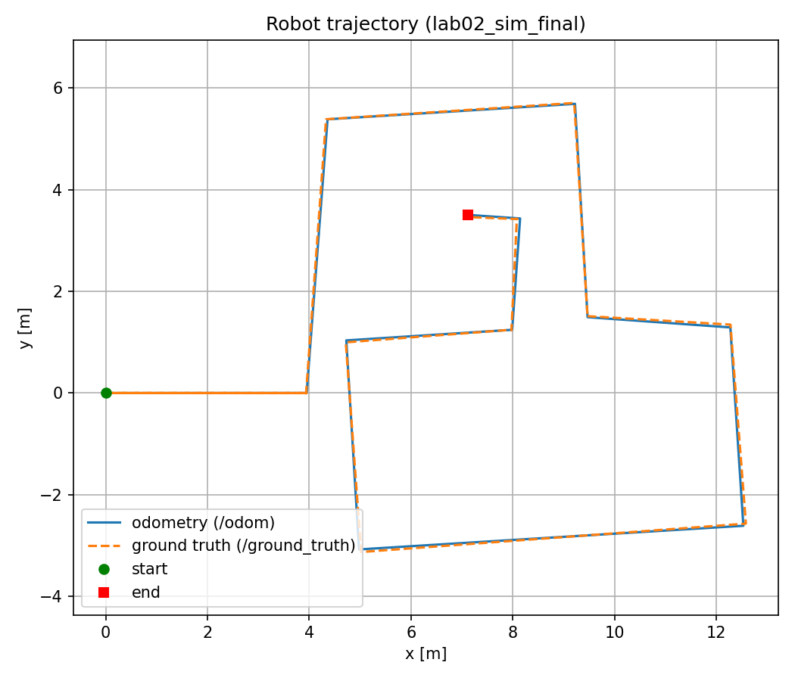
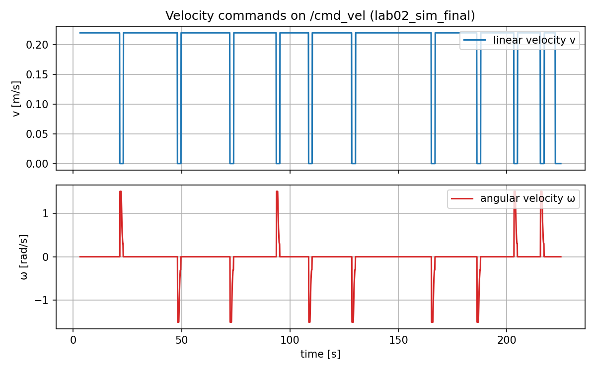
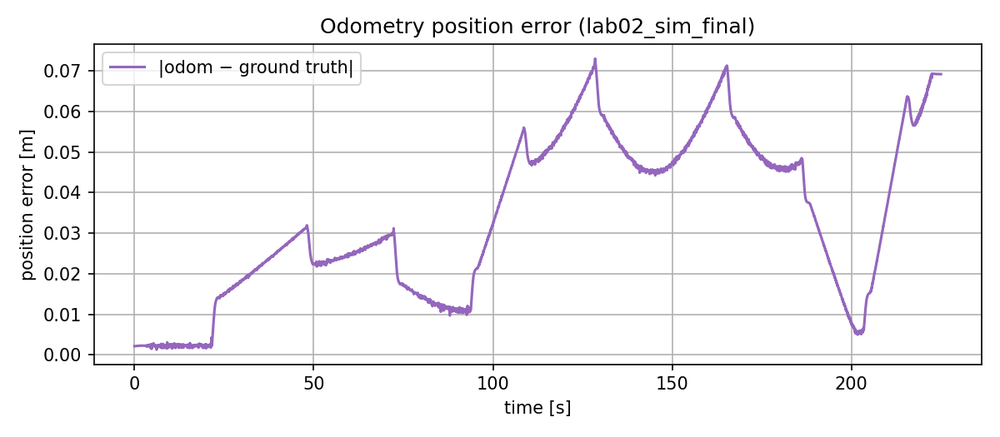
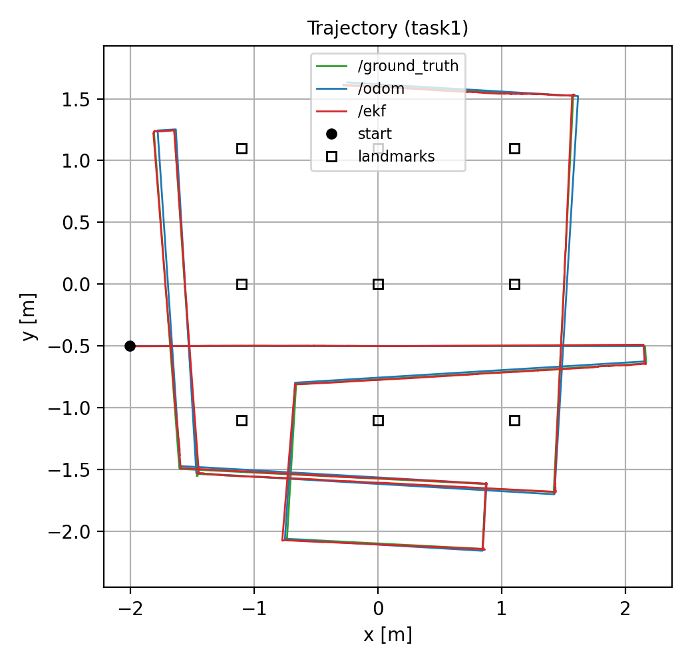
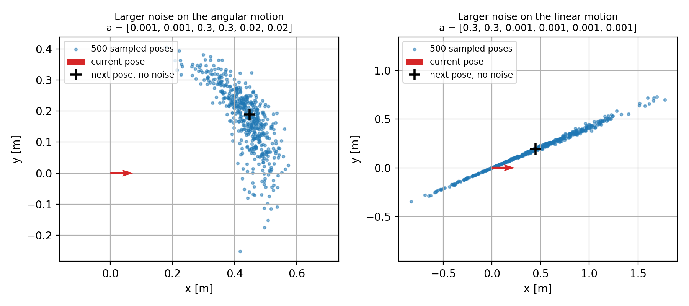

# 🐢 SESASR-SIQUBro

**Lab work of group 203 (SIQUBro) for *Sensors, Embedded Systems and Algorithms for Service Robotics* (SESASR), Politecnico di Torino — TurtleBot3 in simulation and on the real robot.**
**都灵理工大学《服务机器人传感器、嵌入式系统与算法》（SESASR）203 组（SIQUBro）的全部实验：TurtleBot3 仿真 + 真车。**

## 🗺️ The three reports / 三份报告

| Report / 报告 | Topic / 内容 | Labs (course schedule) / 实验（课表编号） | Package / 包 | Deadline / 截止 | Status / 状态 |
|---|---|---|---|---|---|
| **R01** | Bump&Go controller · Bump&Go 控制器 | Lab 2–4 | [`lab02_pkg`](src/lab02_pkg) | 2026-11-09 | ✅ Submitted · 已提交 |
| **R02** | EKF localization with landmarks · 基于地标的 EKF 定位 | Lab 5–7 (lab guide "Lab 04-05-06") | [`lab04_pkg`](src/lab04_pkg) | 2026-11-30 | 🟡 Simulation done, real robot in progress · 仿真完成，真车进行中 |
| **R03** | Control and path planning · 控制与路径规划 | Lab 8–10 | — | 2027-01-08 | ⏳ Not started · 未开始 |

> The package names follow the lab guides (`lab02_pkg` is required by the Lab02 guide; `lab04_pkg` follows the EKF guide "Lab 04-05-06"). / 包名沿用实验指导的编号：`lab02_pkg` 是 Lab02 指导要求的名字，`lab04_pkg` 对应 EKF 指导"Lab 04-05-06"。

## 🗂️ Repository structure / 仓库结构

```
SESASR-SIQUBro/
├── src/
│   ├── lab02_pkg/        # R01 Bump&Go: node, controller, LiDAR utils, configs, launch, tests
│   └── lab04_pkg/        # R02 EKF: models, filter, node, configs, launch, tests, scripts
├── scripts/              # R01 plotting and dead-zone test tools · R01 画图和死区测试工具
├── docs/                 # guides and images · 指南和图片
├── build/ install/ log/  # generated by colcon, not in Git · colcon 生成，不提交
```

New labs go into a new package under `src/` only when they have a separate purpose. Always build from the repository root. / 只有功能独立的新实验才在 `src/` 下新建包；始终在仓库根目录编译。

## ⚡ Quick start / 快速开始

```bash
git clone https://github.com/Denvolatos/SESASR-SIQUBro.git ~/SESASR-SIQUBro
cd ~/SESASR-SIQUBro
source /opt/ros/humble/setup.bash
colcon build --symlink-install
source install/setup.bash
```

`lab04_pkg` also needs the course package [`turtlebot3_perception`](https://github.com/SESASR-Course/turtlebot3_perception) (and `landmark_msgs`) in a sourced workspace. / `lab04_pkg` 还需要课程的 `turtlebot3_perception` 包（含 `landmark_msgs`），并先 source 它所在的工作区。

## 1️⃣ R01 — Bump&Go controller / Bump&Go 控制器

**EN** — The robot always drives straight ahead. When the LiDAR sees a wall closer than 0.5 m, it stops, compares the free space on the left and on the right, and turns towards the more open side using the odometry yaw (90° in simulation; on the real robot it stops turning as soon as the way is free). The same code runs on the real TurtleBot3 with its own parameter file (`config/real_robot.yaml`).

**中文** — 小车一直往前走；激光雷达发现前方 0.5 m 内有墙时停下，比较左右哪边更空，用里程计的偏航角转向更空的一侧（仿真里转 90°；真车上前方一空出来就停止转向）。同一份代码在真车上运行，使用自己的参数文件（`config/real_robot.yaml`）。

```bash
ros2 launch lab02_pkg bump_and_go.launch.py              # simulation (start the Lab02 world first) · 仿真，需先启动 Lab02 场景
ros2 launch lab02_pkg bump_and_go.launch.py robot:=real  # real robot · 真车
```

Final code in the Lab02 maze: goal reached after 10 turns in 220 s; odometry error vs ground truth 0.069 m at the end, 0.073 m maximum. On the real robot the speed limit is 0.15 m/s: at 0.22 m/s it hardly drove forward.
最终版代码在 Lab02 迷宫：转弯 10 次、220 秒到达终点；里程计相对真实位置的误差结束时 0.069 m，最大 0.073 m。真车速度上限为 0.15 m/s：0.22 m/s 时基本不前进。



| Velocity commands / 速度指令 | Odometry error / 里程计误差 |
|---|---|
|  |  |

Guides / 指南：[Operation Guide / 操作流程](docs/OPERATION_GUIDE.md) · [Code Guide / 代码介绍](docs/CODE_GUIDE.md)

## 2️⃣ R02 — EKF localization / EKF 定位

**EN** — An extended Kalman filter estimates the robot pose. It predicts at 20 Hz with the velocity motion model, using v and ω from `/odom`, and corrects the estimate with the range and bearing of each landmark it sees. With `fusion:=true` the state also contains v and ω, which are corrected by `/odom` and `/imu`. The result is published on `/ekf`.

**中文** — 用扩展卡尔曼滤波估计小车位姿：以 20 Hz 用速度运动模型预测（v、ω 取自 `/odom`），每看到一个地标就用它的距离和方位修正。`fusion:=true` 时状态里还包括 v、ω，由 `/odom` 和 `/imu` 修正。结果发布在 `/ekf`。

```bash
ros2 launch turtlebot3_ignition lab04.launch.py      # simulation world (Mac: ignition) · 仿真场景
ros2 launch lab04_pkg ekf.launch.py                  # Task 1: state [x, y, θ]
ros2 launch lab04_pkg ekf.launch.py fusion:=true     # Task 2: state [x, y, θ, v, ω]
ros2 launch lab04_pkg ekf.launch.py robot:=real      # Task 3: real robot, landmarks on /camera/landmarks
```

Simulation, 150 s runs, Bump&Go moving the robot (position RMSE against the ground truth): / 仿真，每次 150 秒，用 Bump&Go 让车动（相对真实位置的位置 RMSE）：

| Run / 实验 | `/odom` | `/ekf` |
|---|---|---|
| Task 1 | 0.018 m | 0.010 m |
| Task 2 | 0.020 m | 0.010 m |

On the same recorded data, Task 2 reduced the heading error by about 20–30 % but did not improve the position. These numbers come from one simulated run each. / 在同一份数据上回放时，Task 2 的航向误差小约 20–30%，位置没有改善。以上数字各来自一次仿真运行。

| Trajectory / 轨迹 | Task 0: velocity motion model samples / 运动模型采样 |
|---|---|
|  |  |

Tools in `src/lab04_pkg/scripts/` / 工具：`task0_models.py` (Task 0 plots, Jacobians with sympy) · `evaluate_ekf.py` (plots, RMSE, MAE) · `replay_filters.py` (both filters on the same bag) · `run_sim_experiment.sh`.

**Replay a real-robot bag / 回放真车数据**（to try other parameters without a new experiment · 不用重做实验就能换参数试）:

```bash
ros2 bag play --clock 1000 --remap /ekf:=/old_ekf -- path/to/rosbag
ros2 launch lab04_pkg ekf.launch.py robot:=real use_sim_time:=true
```

Record `/camera/landmarks` and `/imu` too on the real robot, otherwise the bag cannot be replayed. / 真车上也要录 `/camera/landmarks` 和 `/imu`，否则无法回放。

**Real robot / 真车：** not run yet; the landmark coordinates of the real arena still have to be set in a landmarks file. / 还没跑；真实场地的地标坐标需要写进地标文件。

## 3️⃣ R03 — Control and path planning / 控制与路径规划

Labs on 26/11, 3/12 and 17/12 (Thursday slot). / 实验课：11/26、12/3、12/17（周四场）。

## 👥 Meet the SIQUBro crew / 认识一下 SIQUBro 小分队

> Four humans, one TurtleBot3, zero walls touched (we hope).
> 四个人，一台 TurtleBot3，撞墙次数：0（理论上）。

| | Member | Official title / 官方头衔 | Superpower / 超能力 |
|---|---|---|---|
| 🧭 | **Chen** | Chief Odometry Officer · 首席里程计官 | Knows where the robot *thinks* it is. Where it *really* is — still under investigation. 知道小车*以为*自己在哪；它*实际*在哪，仍在调查中。 |
| 🔦 | **Jin** | Head of LiDAR Affairs · 激光雷达事务部部长 | Can count 230 laser rays in 0.2 s and says `inf` is just "optimism". 0.2 秒数完 230 条激光，坚称 `inf` 只是"乐观"。 |
| 🔄 | **Ye** | Minister of 90° Turns · 九十度转弯部长 | Turns left or right with the confidence of a P controller. 以 P 控制器般的自信左转右转。 |
| 🧱 | **Qu** | Wall Relations Manager · 墙体关系协调员 | Negotiates peace between the robot and every wall within 0.5 m. 负责调解小车与 0.5 m 内所有墙壁的关系。 |

**Team motto / 队训：** *Bump less, go more.* · *少撞墙，多前进。*

## 🙏 Acknowledgements / 致谢

**EN**
- **[DET – Department of Electronics and Telecommunications](https://www.det.polito.it/)**, Politecnico di Torino, and **[PIC4SeR – PoliTO Interdepartmental Centre for Service Robotics](https://pic4ser.polito.it/)**, for the SESASR course, the lab sessions and the TurtleBot3 robots.
- The SESASR course staff for the lab material and the simulation package [`SESASR-Course/turtlebot3_simulations`](https://github.com/SESASR-Course/turtlebot3_simulations).
- **[Claude Code](https://claude.com/claude-code)** (Anthropic's AI coding assistant), which helped with explanations, code review and writing the documentation. All group members have read, run and tested the code and are responsible for it.

**中文**
- 感谢都灵理工大学 **[DET 电子与电信系](https://www.det.polito.it/)** 和 **[PIC4SeR 服务机器人跨系研究中心](https://pic4ser.polito.it/)** 提供 SESASR 课程、实验课和 TurtleBot3 机器人。
- 感谢 SESASR 课程团队提供实验资料和仿真包 [`SESASR-Course/turtlebot3_simulations`](https://github.com/SESASR-Course/turtlebot3_simulations)。
- 感谢 **[Claude Code](https://claude.com/claude-code)**（Anthropic 推出的 AI 编程助手）在讲解原理、检查代码和编写文档方面提供的帮助。小组成员都阅读、运行并测试过代码，并对代码负责。
