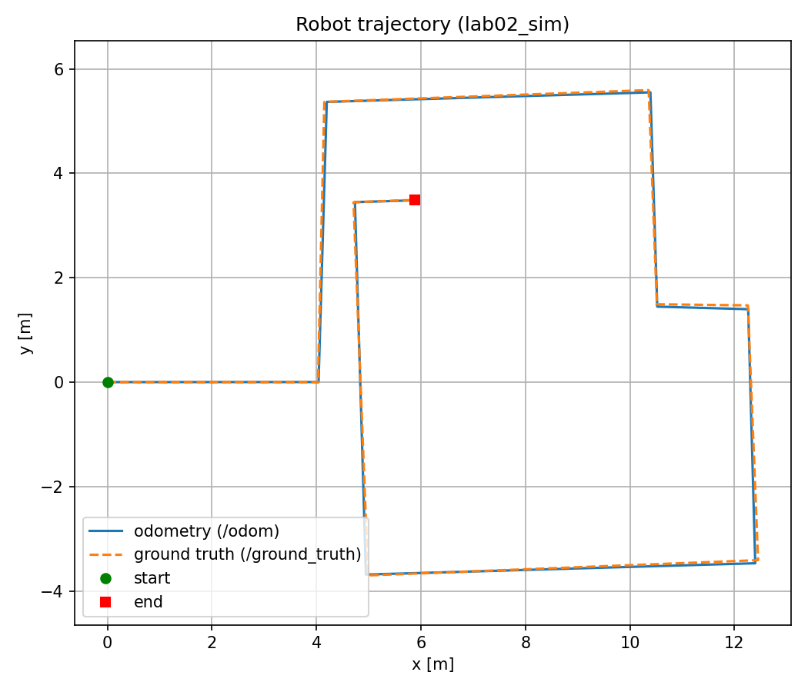
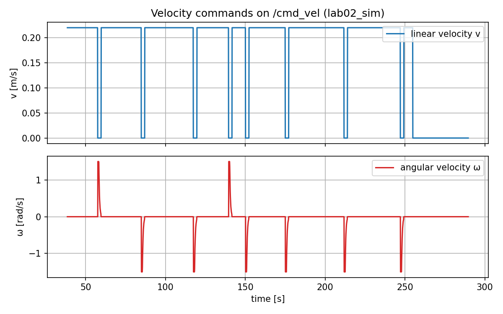
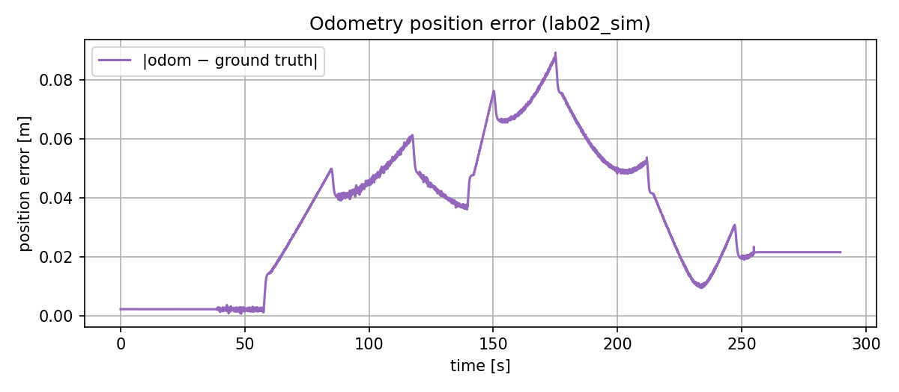

# 🐢 SESASR-SIQUBro

**A Bump&Go controller that drives a TurtleBot3 through a maze — in simulation and on the real robot.**
**一个让 TurtleBot3 自己走出迷宫的 Bump&Go 控制器：仿真和真车都能跑。**

Group repository for the labs of *Sensors, Embedded Systems and Algorithms for Service Robotics* (SESASR), Politecnico di Torino.
都灵理工大学《服务机器人传感器、嵌入式系统与算法》（SESASR）课程实验小组仓库。



## 📚 Documentation / 文档

| | Document / 文档 | For / 适合 |
|---|---|---|
| 🚀 | **[Operation Guide / 操作流程](docs/OPERATION_GUIDE.md)** | Install, run in simulation, run on the real robot, record and plot, troubleshooting — step by step from zero. 安装、仿真、真车、录数据画图、常见问题，零基础分步操作。 |
| 📖 | **[Code Guide / 代码介绍指南](docs/CODE_GUIDE.md)** | How the controller works, section by section, parameters, oral-exam questions. 控制器逐段讲解、参数说明、答辩准备题。 |

> 🆕 **New to ROS 2? / 第一次用 ROS 2？** Start from the [Operation Guide](docs/OPERATION_GUIDE.md). / 从[操作流程](docs/OPERATION_GUIDE.md)开始。

## 💡 About the project / 项目简介

**EN** — The robot always drives straight ahead. When the LiDAR sees a wall closer than 0.5 m, it stops, compares the free space on the left and on the right, and turns 90° towards the more open side using the odometry yaw. Repeat until the green cube is reached. The same code runs on the real TurtleBot3 (sensor QoS, no ground truth, ray directions computed from the scan metadata).

**中文** — 小车一直往前走；激光雷达发现前方 0.5 m 内有墙时停下，比较左右哪边空间更大，用里程计的偏航角控制，向更空的一侧转 90°，如此反复，直到到达绿色方块。同一份代码可以直接在真车上运行（传感器 QoS、不依赖 ground truth、光束方向由雷达数据计算）。

| Lab | Content / 内容 | Report / 报告 |
|---|---|---|
| Lab02 | Gazebo simulation + Bump&Go · 仿真 + Bump&Go | R01 |
| Lab03 / Lab04 | Real TurtleBot3 · 真车测试 | R01 |

## 🗂️ Repository structure / 仓库结构

```
SESASR-SIQUBro/
├── lab02_pkg/            # ROS 2 package with the bump_and_go node · 控制器 ROS 2 包
├── scripts/plot_bag.py   # rosbag -> report plots (PDF/PNG) · 把 rosbag 画成报告图
└── docs/                 # guides and example plots · 指南和示例图
```

## ⚡ Quick start / 快速开始

```bash
cd ~/ros2_ws/src && git clone https://github.com/Denvolatos/SESASR-SIQUBro.git
cd ~/ros2_ws && colcon build --symlink-install && source install/setup.bash
ros2 run lab02_pkg bump_and_go            # simulation must be running · 需先启动仿真
```

Full instructions / 完整步骤 → [Operation Guide](docs/OPERATION_GUIDE.md)

## ✅ Result in simulation / 仿真结果

Goal reached after 8 turns in ~4 min; odometry error vs ground truth: 0.022 m at the end, 0.089 m maximum.
转弯 8 次、约 4 分钟到达终点；里程计相对真实位置的误差：结束时 0.022 m，最大 0.089 m。

| Velocity commands / 速度指令 | Odometry error / 里程计误差 |
|---|---|
|  |  |

## 👥 Meet the SIQUBro crew / 认识一下 SIQUBro 小分队

> Four humans, one TurtleBot3, zero walls touched (we hope).
> 四个人，一台 TurtleBot3，撞墙次数：0（理论上）。

| | Member | Official title / 官方头衔 | Superpower / 超能力 |
|---|---|---|---|
| 🧭 | **Chen** | Chief Odometry Officer · 首席里程计官 | Knows where the robot *thinks* it is. Where it *really* is — still under investigation. 知道小车*以为*自己在哪；它*实际*在哪，仍在调查中。 |
| 🔦 | **Jin** | Head of LiDAR Affairs · 激光雷达事务部部长 | Can count 230 laser rays in 0.2 s and says `inf` is just "optimism". 0.2 秒数完 230 条激光，坚称 `inf` 只是"乐观"。 |
| 🔄 | **Ye** | Minister of 90° Turns · 九十度转弯部长 | Turns left or right with the confidence of a P controller. 以 P 控制器般的自信左转右转。 |
| 🧱 | **Qu** | Wall Relations Manager · 墙体关系协调员 | Negotiates peace between the robot and every wall within 0.5 m. 负责调解小车与 0.5 m 内所有墙壁的关系。 |

**Team motto / 队训：** *Bump less, go more.* · *少撞墙，多前进。*

## 🙏 Acknowledgements / 致谢

**EN**
- **[DET – Department of Electronics and Telecommunications](https://www.det.polito.it/)**, Politecnico di Torino, and **[PIC4SeR – PoliTO Interdepartmental Centre for Service Robotics](https://pic4ser.polito.it/)**, for the SESASR course, the lab sessions and the TurtleBot3 robots.
- The SESASR course staff for the lab material and the simulation package [`SESASR-Course/turtlebot3_simulations`](https://github.com/SESASR-Course/turtlebot3_simulations).
- **[Claude Code](https://claude.com/claude-code)** (Anthropic's AI coding assistant), which helped with explanations, code review and writing the documentation. All group members have read, run and tested the code and are responsible for it.

**中文**
- 感谢都灵理工大学 **[DET 电子与电信系](https://www.det.polito.it/)** 和 **[PIC4SeR 服务机器人跨系研究中心](https://pic4ser.polito.it/)** 提供 SESASR 课程、实验课和 TurtleBot3 机器人。
- 感谢 SESASR 课程团队提供实验资料和仿真包 [`SESASR-Course/turtlebot3_simulations`](https://github.com/SESASR-Course/turtlebot3_simulations)。
- 感谢 **[Claude Code](https://claude.com/claude-code)**（Anthropic 推出的 AI 编程助手）在讲解原理、检查代码和编写文档方面提供的帮助。小组成员都阅读、运行并测试过代码，并对代码负责。
