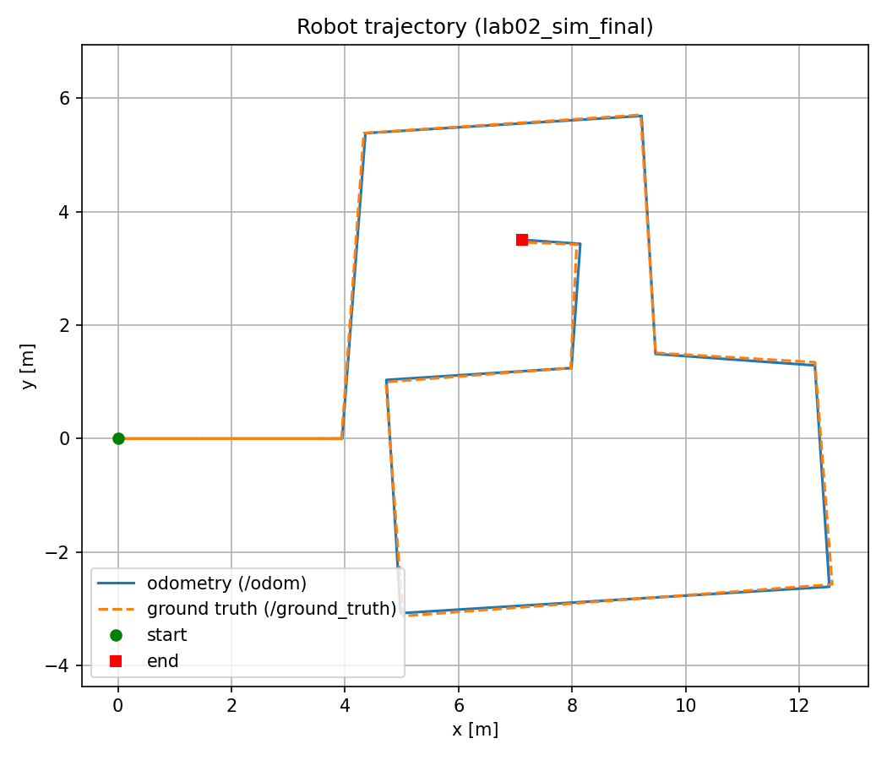
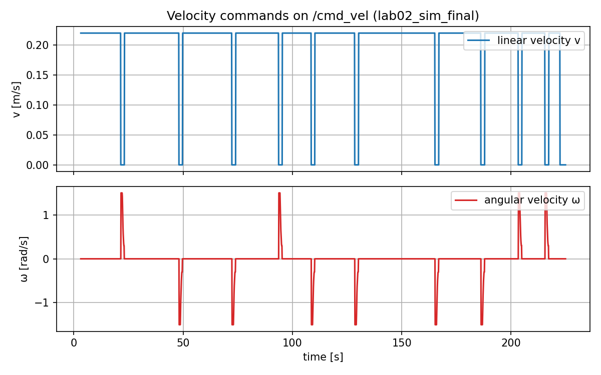
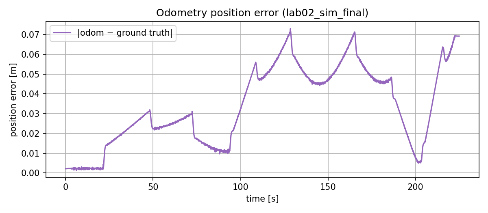
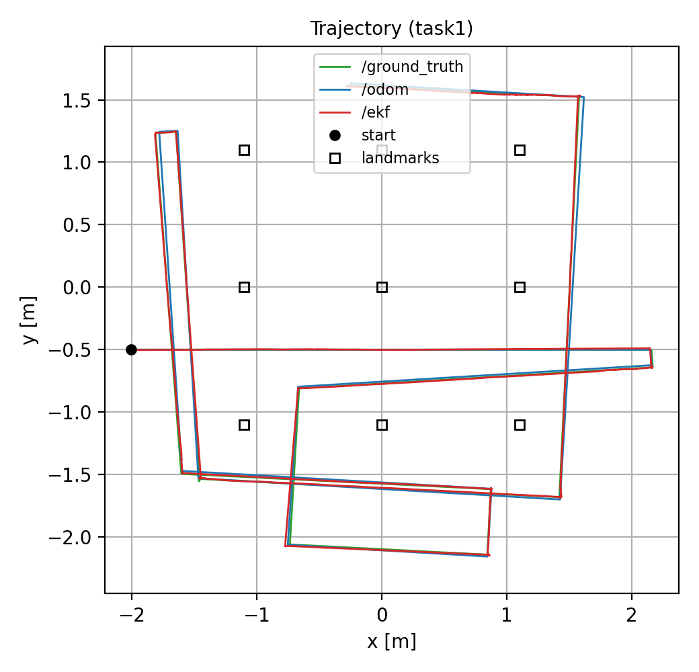
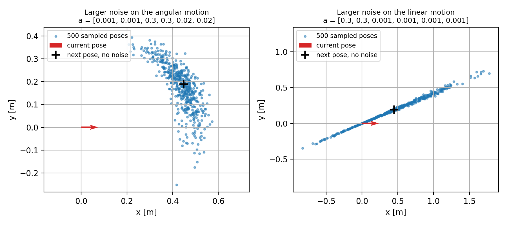

<div align="center">

# 🐢 SESASR-SIQUBro

**Lab work of group 203 (SIQUBro) for *Sensors, Embedded Systems and Algorithms for Service Robotics* (SESASR), Politecnico di Torino.**<br>
TurtleBot3 in simulation and on the real robot: Bump&Go, EKF localization, DWA navigation.

   

[中文](README.zh-CN.md) · [Italiano](README.it.md) · [Operation Guide](docs/OPERATION_GUIDE.md) · [Code Guide](docs/CODE_GUIDE.md) · [License and code sources](#-license-and-code-sources)



</div>

## 🗺️ The three reports

| Report | Topic | Labs (course schedule) | Package | Deadline | Status |
|---|---|---|---|---|---|
| **R01** | Bump&Go controller | Lab 2–4 | [`lab02_pkg`](src/lab02_pkg) | 2026-11-09 | ✅ Submitted |
| **R02** | EKF localization with landmarks | Lab 5–7 (lab guide "Lab 04-05-06") | [`lab04_pkg`](src/lab04_pkg) | 2026-11-30 | 🟡 Experiments done (simulation + real robot), report in progress |
| **R03** | DWA obstacle avoidance and target following | Lab 8–10 (lab guide "07-08-09") | [`lab07_pkg`](src/lab07_pkg) | 2027-01-08 | 🟡 Simulation done, real robot on 3/12 and 17/12 |

> The package names follow the lab guides: `lab02_pkg` is required by the Lab02 guide, `lab04_pkg` follows the EKF guide "Lab 04-05-06" and `lab07_pkg` follows the DWA guide "07-08-09".

## 🗂️ Repository structure

```
SESASR-SIQUBro/
├── src/
│   ├── lab02_pkg/        # R01 Bump&Go: node, controller, LiDAR utils, configs, launch, tests
│   ├── lab04_pkg/        # R02 EKF: models, filter, node, configs, launch, tests, scripts
│   └── lab07_pkg/        # R03 DWA: planner, scan processing, navigation, node, configs, tests, scripts
├── scripts/              # R01 plotting and dead-zone test tools
├── docs/                 # guides and images
├── build/ install/ log/  # generated by colcon, not in Git
```

New labs go into a new package under `src/` only when they have a separate purpose. Always build from the repository root.

## ⚡ Quick start

```bash
git clone https://github.com/Denvolatos/SESASR-SIQUBro.git ~/SESASR-SIQUBro
cd ~/SESASR-SIQUBro
source /opt/ros/humble/setup.bash
colcon build --symlink-install
source install/setup.bash
```

`lab04_pkg` (and `lab07_pkg` when it follows an AprilTag on the real robot) also needs the course package [`turtlebot3_perception`](https://github.com/SESASR-Course/turtlebot3_perception) (and `landmark_msgs`) in a sourced workspace.

## 1️⃣ R01 — Bump&Go controller

The robot always drives straight ahead. When the LiDAR sees a wall closer than 0.5 m, it stops, compares the free space on the left and on the right, and turns towards the more open side using the odometry yaw (90° in simulation; on the real robot it stops turning as soon as the way is free). The same code runs on the real TurtleBot3 with its own parameter file (`config/real_robot.yaml`).

```bash
ros2 launch lab02_pkg bump_and_go.launch.py              # simulation (start the Lab02 world first)
ros2 launch lab02_pkg bump_and_go.launch.py robot:=real  # real robot
```

Final code in the Lab02 maze: goal reached after 10 turns in 220 s; odometry error vs ground truth 0.069 m at the end, 0.073 m maximum. On the real robot the speed limit is 0.15 m/s: at 0.22 m/s it hardly drove forward.

| Velocity commands | Odometry error |
|---|---|
|  |  |

## 2️⃣ R02 — EKF localization

An extended Kalman filter estimates the robot pose. It predicts at 20 Hz with the velocity motion model, using v and ω from `/odom`, and corrects the estimate with the range and bearing of each landmark it sees. With `fusion:=true` the state also contains v and ω, which are corrected by `/odom` and `/imu`. The result is published on `/ekf`.

```bash
ros2 launch turtlebot3_ignition lab04.launch.py      # simulation world (Mac: ignition)
ros2 launch lab04_pkg ekf.launch.py                  # Task 1: state [x, y, θ]
ros2 launch lab04_pkg ekf.launch.py fusion:=true     # Task 2: state [x, y, θ, v, ω]
ros2 launch lab04_pkg ekf.launch.py robot:=real      # Task 3: real robot, landmarks on /camera/landmarks
```

Simulation, 150 s runs, Bump&Go moving the robot (position RMSE against the ground truth):

| Run | `/odom` | `/ekf` |
|---|---|---|
| Task 1 | 0.018 m | 0.010 m |
| Task 2 | 0.020 m | 0.010 m |

On the same recorded data, Task 2 reduced the heading error by about 20–30 % but did not improve the position. These numbers come from one simulated run each; the course metrics tool gives the same values (within 0.5 mm).

| Trajectory | Task 0: velocity motion model samples |
|---|---|
|  |  |

Tools in `src/lab04_pkg/scripts/`: `task0_models.py` (Task 0 plots, Jacobians with sympy) · `evaluate_ekf.py` (plots, RMSE, MAE) · `replay_filters.py` (both filters on the same bag) · `run_sim_experiment.sh`.

**Replay a real-robot bag** (to try other parameters without a new experiment):

```bash
ros2 bag play --clock 1000 --remap /ekf:=/old_ekf -- path/to/rosbag
ros2 launch lab04_pkg ekf.launch.py robot:=real use_sim_time:=true
```

Record `/camera/landmarks` and `/imu` too on the real robot, otherwise the bag cannot be replayed.

**On the robot**, after the four robot launches (zenoh router, bringup, camera, apriltag):

```bash
LANDMARKS=$HOME/tag_positions.txt bash src/lab04_pkg/scripts/robot_task3.sh run1 X Y THETA
```

It checks the robot topics, builds the package, starts the EKF with the landmarks of the day and records a bag in `~/g203_bags/`; Ctrl+C stops everything cleanly. If the EKF does not start, the raw topics are still recorded.

**Real robot (19 Nov 2026, robot 3):** the robot started at the map origin, the cross on the floor (0, 0, 0). With the Task 2 filter, a 172 s drive around the obstacles saw 7 of the 9 tags, and at the end `/ekf` and `/odom` were 0.28 m apart. There is no ground truth on the real robot, so this only shows that the two estimates agree with each other and with the tag measurements, not how accurate they are.

Things we learned on the robot:
- The tags are moved for every lab session: use the `tag_positions.txt` of the day (`LANDMARKS=...`). `config/landmarks_thu1211.yaml` is only the arena of 12 Nov.
- With a wrong start pose and only one tag in view, the position has two solutions: in one run the filter first settled on the wrong one and jumped to the right one 44 s later, when more tags came into view. Start where the camera sees two or more tags.
- The robot PC has no internet: copy the code to it (`scp`) instead of `git clone`. Changing the battery restarts the whole robot, so all four launches have to be started again.

## 3️⃣ R03 — DWA obstacle avoidance and target following

A Dynamic Window Approach controller runs at 15 Hz. It samples (v, ω) inside the dynamic window, simulates each trajectory for 1.5 s and scores it with J = α·heading + β·vel + γ·dist_obst; trajectories that would come too close to an obstacle are removed first. Obstacles come only from the LiDAR, reduced to 24 sectors (NaN, Inf and zero readings are handled, single-ray spikes are removed with a 3-point median). An independent laser safety stop ends the run with `Collision`. For Task 2 (following a moving target) the score also has vel′ (slow down near the target) and dist_target (keep about 0.8 m and the target in the camera view). Results are published on `/nav_result` (`Goal`, `Collision`, `Timeout`, `Lost`).

```bash
ros2 launch turtlebot3_ignition project.launch.py           # simulation world
ros2 launch lab07_pkg dwa.launch.py                         # Task 1: static goal on /goal_pose
ros2 launch lab07_pkg dwa.launch.py mode:=follow            # Task 2: follow /dynamic_goal_pose
ros2 launch lab07_pkg dwa.launch.py robot:=real             # Task 3: real robot, static goal
ros2 launch lab07_pkg dwa.launch.py robot:=real mode:=follow target_id:=N   # Task 3: follow AprilTag N
```

Send a goal: `ros2 topic pub --once /goal_pose geometry_msgs/msg/PoseStamped "{header: {frame_id: odom}, pose: {position: {x: 1.5, y: -0.5}}}"`

Simulation (course world `hard_maze.world`, robot starting at the origin):
- **Task 1:** 8 goals × 3 runs: 24 / 24 reached, no collision. Four other goals behind the central walls end in `Timeout`: the robot is caught in a local minimum, a known limit of DWA.
- **Task 2:** on the course trajectory of the red cube, 3 / 3 runs followed the whole first lap (about 21 m) with no collision. The cube cuts a corner 0.115 m from a wall, so the robot falls behind there (up to 3.5–4.9 m) and then catches up; mean distance over the lap 2.0–2.8 m.

Tools in `src/lab07_pkg/scripts/`: `evaluate_nav.py` (success rate, time, path length, obstacle distance, velocity and trajectory plots from a bag) · `run_goal_trials.sh` + `run_single_trial.py` (repeated Gazebo trials) · `offline_sim.py` (pure-Python simulation for quick tests, not a replacement for Gazebo).

## 👥 Meet the SIQUBro crew

> Four humans, one TurtleBot3, zero walls touched (we hope).

| | Member | Official title | Superpower |
|---|---|---|---|
| 🧭 | **Chen** | Chief Odometry Officer | Knows where the robot *thinks* it is. Where it *really* is — still under investigation. |
| 🔦 | **Jin** | Head of LiDAR Affairs | Can count 230 laser rays in 0.2 s and says `inf` is just "optimism". |
| 🔄 | **Ye** | Minister of 90° Turns | Turns left or right with the confidence of a P controller. |
| 🧱 | **Qu** | Wall Relations Manager | Negotiates peace between the robot and every wall within 0.5 m. |

**Team motto:** *Bump less, go more.*

## 📜 License and code sources

All packages are released under the **GNU General Public License v3.0 or later** (see `LICENSE` in each package).

Parts of the code are adapted from course material released under GPL-3.0:
- `lab04_pkg/lab04_pkg/ekf.py` — from [`maurom3197/probabilistic-robotics-python-examples`](https://github.com/maurom3197/probabilistic-robotics-python-examples).
- `lab07_pkg/lab07_pkg/dwa.py` — from [`SESASR-Course/planning_control_methods`](https://github.com/SESASR-Course/planning_control_methods) (Controllers module), with the changes listed at the top of the file.

## 🙏 Acknowledgements

- **[DET – Department of Electronics and Telecommunications](https://www.det.polito.it/)**, Politecnico di Torino, and **[PIC4SeR – PoliTO Interdepartmental Centre for Service Robotics](https://pic4ser.polito.it/)**, for the SESASR course, the lab sessions and the TurtleBot3 robots.
- The SESASR course staff for the lab material and the simulation package [`SESASR-Course/turtlebot3_simulations`](https://github.com/SESASR-Course/turtlebot3_simulations).
- **[Claude Code](https://claude.com/claude-code)** (Anthropic's AI coding assistant), which helped with explanations, code review and writing the documentation; **[Google Antigravity](https://antigravity.google/)** (Gemini), which helped write the R03 code; and **[OpenAI Codex](https://openai.com/codex/)**, which helped write part of the R01 code. All group members have read, run and tested the code and are responsible for it.
