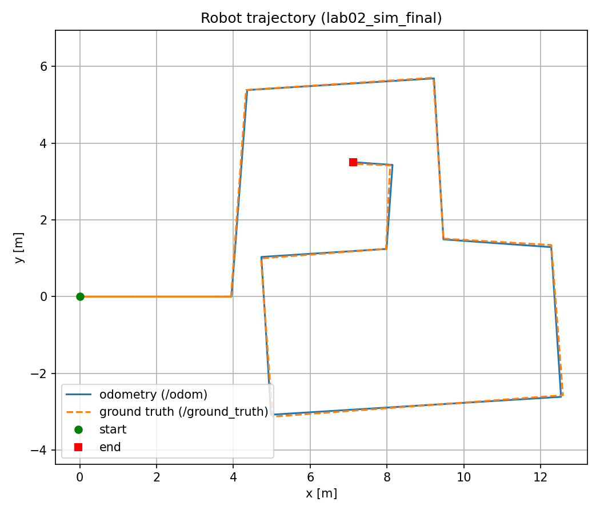
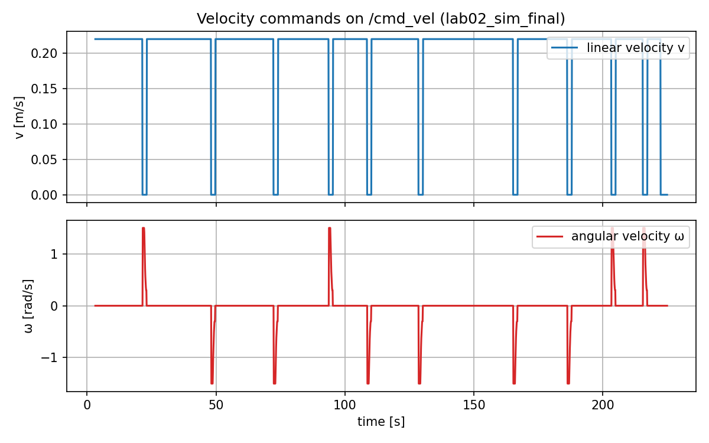
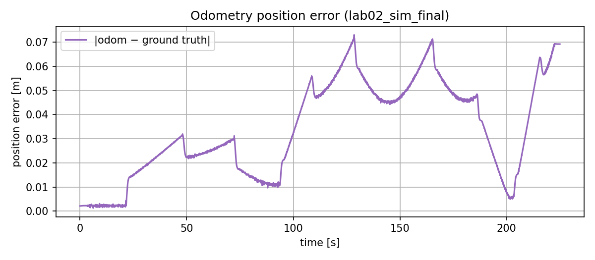
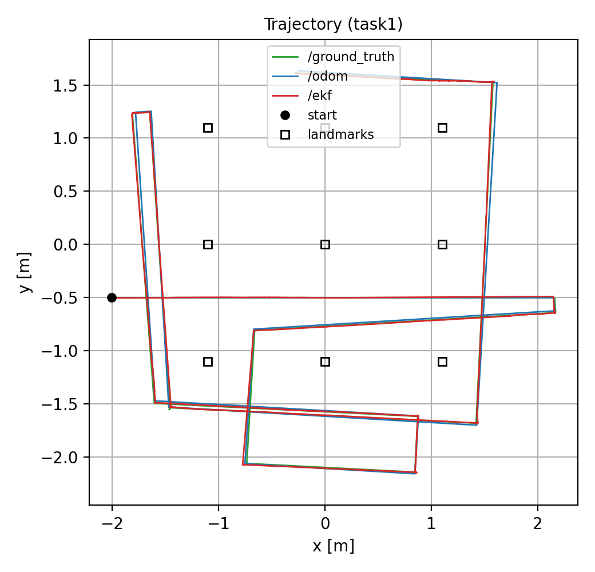
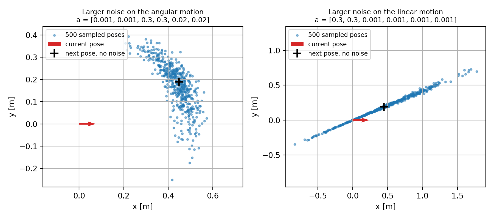

<div align="center">

# 🐢 SESASR-SIQUBro

**都灵理工大学《服务机器人传感器、嵌入式系统与算法》（SESASR）203 组（SIQUBro）的全部实验。**<br>
TurtleBot3 仿真 + 真车：Bump&Go、EKF 定位、DWA 导航。

   

[English](README.md) · [Italiano](README.it.md) · [操作流程](docs/OPERATION_GUIDE.md#-中文) · [代码介绍](docs/CODE_GUIDE.md#-中文) · [许可证和代码来源](#-许可证和代码来源)



</div>

## 🗺️ 三份报告

| 报告 | 内容 | 实验（课表编号） | 包 | 截止 | 状态 |
|---|---|---|---|---|---|
| **R01** | Bump&Go 控制器 | Lab 2–4 | [`lab02_pkg`](src/lab02_pkg) | 2026-11-09 | ✅ 已提交 |
| **R02** | 基于地标的 EKF 定位 | Lab 5–7（实验指导"Lab 04-05-06"） | [`lab04_pkg`](src/lab04_pkg) | 2026-11-30 | 🟡 实验完成（仿真 + 真车），报告撰写中 |
| **R03** | DWA 避障与目标跟随 | Lab 8–10（实验指导"07-08-09"） | [`lab07_pkg`](src/lab07_pkg) | 2027-01-08 | 🟡 仿真完成，真车 12/3、12/17 |

> 包名沿用实验指导的编号：`lab02_pkg` 是 Lab02 指导要求的名字，`lab04_pkg` 对应 EKF 指导"Lab 04-05-06"，`lab07_pkg` 对应 DWA 指导"07-08-09"。

## 🗂️ 仓库结构

```
SESASR-SIQUBro/
├── src/
│   ├── lab02_pkg/        # R01 Bump&Go：节点、控制器、激光工具、参数、launch、测试
│   ├── lab04_pkg/        # R02 EKF：模型、滤波器、节点、参数、launch、测试、脚本
│   └── lab07_pkg/        # R03 DWA：规划器、激光处理、导航、节点、参数、测试、脚本
├── scripts/              # R01 画图和死区测试工具
├── docs/                 # 指南和图片
├── build/ install/ log/  # colcon 生成，不提交
```

只有功能独立的新实验才在 `src/` 下新建包；始终在仓库根目录编译。

## ⚡ 快速开始

```bash
git clone https://github.com/Denvolatos/SESASR-SIQUBro.git ~/SESASR-SIQUBro
cd ~/SESASR-SIQUBro
source /opt/ros/humble/setup.bash
colcon build --symlink-install
source install/setup.bash
```

`lab04_pkg`（以及真车上跟随 AprilTag 时的 `lab07_pkg`）还需要课程的 [`turtlebot3_perception`](https://github.com/SESASR-Course/turtlebot3_perception) 包（含 `landmark_msgs`），并先 source 它所在的工作区。

## 1️⃣ R01 — Bump&Go 控制器

小车一直往前走；激光雷达发现前方 0.5 m 内有墙时停下，比较左右哪边更空，用里程计的偏航角转向更空的一侧（仿真里转 90°；真车上前方一空出来就停止转向）。同一份代码在真车上运行，使用自己的参数文件（`config/real_robot.yaml`）。

```bash
ros2 launch lab02_pkg bump_and_go.launch.py              # 仿真，需先启动 Lab02 场景
ros2 launch lab02_pkg bump_and_go.launch.py robot:=real  # 真车
```

最终版代码在 Lab02 迷宫：转弯 10 次、220 秒到达终点；里程计相对真实位置的误差结束时 0.069 m，最大 0.073 m。真车速度上限为 0.15 m/s：0.22 m/s 时基本不前进。

| 速度指令 | 里程计误差 |
|---|---|
|  |  |

## 2️⃣ R02 — EKF 定位

用扩展卡尔曼滤波估计小车位姿：以 20 Hz 用速度运动模型预测（v、ω 取自 `/odom`），每看到一个地标就用它的距离和方位修正。`fusion:=true` 时状态里还包括 v、ω，由 `/odom` 和 `/imu` 修正。结果发布在 `/ekf`。

```bash
ros2 launch turtlebot3_ignition lab04.launch.py      # 仿真场景（Mac：ignition）
ros2 launch lab04_pkg ekf.launch.py                  # Task 1：状态 [x, y, θ]
ros2 launch lab04_pkg ekf.launch.py fusion:=true     # Task 2：状态 [x, y, θ, v, ω]
ros2 launch lab04_pkg ekf.launch.py robot:=real      # Task 3：真车，地标来自 /camera/landmarks
```

仿真，每次 150 秒，用 Bump&Go 让车动（相对真实位置的位置 RMSE）：

| 实验 | `/odom` | `/ekf` |
|---|---|---|
| Task 1 | 0.018 m | 0.010 m |
| Task 2 | 0.020 m | 0.010 m |

在同一份数据上回放时，Task 2 的航向误差小约 20–30%，位置没有改善。以上数字各来自一次仿真运行；用课程提供的指标工具算出的结果相同（差 < 0.5 mm）。

| 轨迹 | Task 0：速度运动模型采样 |
|---|---|
|  |  |

`src/lab04_pkg/scripts/` 里的工具：`task0_models.py`（Task 0 的图，用 sympy 推雅可比）· `evaluate_ekf.py`（画图、RMSE、MAE）· `replay_filters.py`（两种滤波器跑同一份 bag）· `run_sim_experiment.sh`。

**回放真车数据**（不用重做实验就能换参数试）：

```bash
ros2 bag play --clock 1000 --remap /ekf:=/old_ekf -- path/to/rosbag
ros2 launch lab04_pkg ekf.launch.py robot:=real use_sim_time:=true
```

真车上也要录 `/camera/landmarks` 和 `/imu`，否则无法回放。

**在车上**，先启动车上的四个程序（zenoh 路由器、bringup、摄像头、apriltag），再运行：

```bash
LANDMARKS=$HOME/tag_positions.txt bash src/lab04_pkg/scripts/robot_task3.sh run1 X Y THETA
```

脚本检查车上的话题、编译、用当天的地标启动 EKF，并把 bag 录到 `~/g203_bags/`；Ctrl+C 一次全部正常停止。EKF 起不来时照样录原始数据。

**真车（2026-11-19，3 号车）：** 小车从地图原点（地上的十字，(0, 0, 0)）出发。用 Task 2 滤波器绕障碍物开了 172 秒，9 个地标看到 7 个，结束时 `/ekf` 与 `/odom` 相差 0.28 m。真车没有真实位置可比，所以这只说明两者彼此一致、并与地标观测相符，不代表绝对精度。

真车上的经验：
- 每次实验课地标位置都不同，要用当天的 `tag_positions.txt`（`LANDMARKS=...`）；`config/landmarks_thu1211.yaml` 只是 11/12 的场地。
- 起点填错、又只看得到一个地标时，位置有两个解：有一次滤波器先停在错误的解上，44 秒后看到更多地标才跳回正确位置。起步时最好能看到两个以上地标。
- 车上的电脑不能上网，代码要用 `scp` 拷过去，不能 `git clone`；换电池会让整台车重启，四个程序都要重开。

## 3️⃣ R03 — DWA 避障与目标跟随

DWA 控制器以 15 Hz 运行：在动态窗口里采样 (v, ω)，每条轨迹向前模拟 1.5 秒，用 J = α·heading + β·vel + γ·dist_obst 打分；离障碍太近的轨迹先剔除。障碍只来自激光雷达，压缩成 24 个扇区（处理 NaN、Inf 和 0，三点中值滤掉单条射线的毛刺）。另有一个独立的激光急停，触发时结果为 `Collision`。Task 2（跟随移动目标）在打分里加上 vel′（接近目标时减速）和 dist_target（保持约 0.8 m、目标在摄像头视野里）。结果发布在 `/nav_result`（`Goal`、`Collision`、`Timeout`、`Lost`）。

```bash
ros2 launch turtlebot3_ignition project.launch.py           # 仿真场景
ros2 launch lab07_pkg dwa.launch.py                         # Task 1：静态目标，发到 /goal_pose
ros2 launch lab07_pkg dwa.launch.py mode:=follow            # Task 2：跟随 /dynamic_goal_pose
ros2 launch lab07_pkg dwa.launch.py robot:=real             # Task 3：真车，静态目标
ros2 launch lab07_pkg dwa.launch.py robot:=real mode:=follow target_id:=N   # Task 3：跟随 N 号 AprilTag
```

发目标：`ros2 topic pub --once /goal_pose geometry_msgs/msg/PoseStamped "{header: {frame_id: odom}, pose: {position: {x: 1.5, y: -0.5}}}"`

仿真（课程地图 `hard_maze.world`，车从原点出发）：
- **Task 1：** 8 个目标各 3 次：24 / 24 到达，无碰撞。另有 4 个在中间墙后面的目标会 `Timeout`：车陷入局部极小，这是 DWA 已知的局限。
- **Task 2：** 在课程给定的红色方块路线上，3 / 3 次跟完第一圈（约 21 m），无碰撞。方块在离墙 0.115 m 处切过墙角，车在那里会落后（最多 3.5–4.9 m），之后再追上；整圈平均距离 2.0–2.8 m。

`src/lab07_pkg/scripts/` 里的工具：`evaluate_nav.py`（从 bag 算成功率、用时、路径长度、离障碍距离，画速度曲线和轨迹）· `run_goal_trials.sh` + `run_single_trial.py`（在 Gazebo 里重复试验）· `offline_sim.py`（纯 Python 仿真，只用于快速测试，不能代替 Gazebo）。

## 👥 认识一下 SIQUBro 小分队

> 四个人，一台 TurtleBot3，撞墙次数：0（理论上）。

| | 成员 | 官方头衔 | 超能力 |
|---|---|---|---|
| 🧭 | **Chen** | 首席里程计官 | 知道小车*以为*自己在哪；它*实际*在哪，仍在调查中。 |
| 🔦 | **Jin** | 激光雷达事务部部长 | 0.2 秒数完 230 条激光，坚称 `inf` 只是"乐观"。 |
| 🔄 | **Ye** | 九十度转弯部长 | 以 P 控制器般的自信左转右转。 |
| 🧱 | **Qu** | 墙体关系协调员 | 负责调解小车与 0.5 m 内所有墙壁的关系。 |

**队训：** *少撞墙，多前进。*

## 📜 许可证和代码来源

所有包都以 **GNU 通用公共许可证 v3.0 或更新版本（GPL-3.0-or-later）** 发布，见各包里的 `LICENSE`。

部分代码改写自以 GPL-3.0 发布的课程资料：
- `lab04_pkg/lab04_pkg/ekf.py` —— 改写自课程的概率机器人示例仓库 [`maurom3197/probabilistic-robotics-python-examples`](https://github.com/maurom3197/probabilistic-robotics-python-examples)。
- `lab07_pkg/lab07_pkg/dwa.py` —— 改写自课程的 DWA 代码 [`SESASR-Course/planning_control_methods`](https://github.com/SESASR-Course/planning_control_methods)（Controllers 模块），改动列在文件开头。

## 🙏 致谢

- 感谢都灵理工大学 **[DET 电子与电信系](https://www.det.polito.it/)** 和 **[PIC4SeR 服务机器人跨系研究中心](https://pic4ser.polito.it/)** 提供 SESASR 课程、实验课和 TurtleBot3 机器人。
- 感谢 SESASR 课程团队提供实验资料和仿真包 [`SESASR-Course/turtlebot3_simulations`](https://github.com/SESASR-Course/turtlebot3_simulations)。
- 感谢 **[Claude Code](https://claude.com/claude-code)**（Anthropic 推出的 AI 编程助手）在讲解原理、检查代码和编写文档方面提供的帮助，以及 **[Google Antigravity](https://antigravity.google/)**（Gemini）在编写 R03 代码方面、**[OpenAI Codex](https://openai.com/codex/)** 在编写部分 R01 代码方面提供的帮助。小组成员都阅读、运行并测试过代码，并对代码负责。
